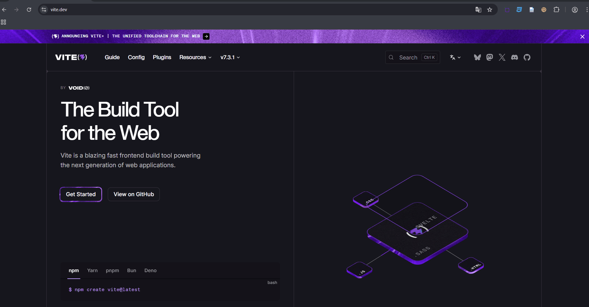

# Copy Selector (WXT)

Extensión de Chrome construida con [WXT](https://wxt.dev) (Next-gen Web Extension Framework) que te permite copiar selectores CSS completos desde el elemento `<main>` (o `<body>`) hasta el elemento objetivo, con opciones personalizables.

## 🚀 Características

- **Generación automática de selectores**: Crea selectores CSS desde el elemento raíz hasta el objetivo
- **Múltiples estrategias de generación**: Elige entre diferentes métodos de generación
  - **Completo**: Ruta completa con todos los atributos configurados
  - **Nth-child**: Usa nth-child/nth-of-type para posicionamiento relativo
  - **Optimizado**: Genera el selector único más corto posible
- **Opciones personalizables**: Control total sobre qué incluir en el selector
  - Tags HTML (siempre incluidos)
  - IDs (#element-id)
  - Clases (.class-name)
  - Atributos ([data-*="value"])
- **Vista previa en tiempo real**: Muestra el selector antes de copiarlo
- **Interfaz moderna**: Diseño limpio y profesional con modo oscuro
- **Feedback visual**: Resaltado del elemento y notificaciones

## 📦 Instalación y Desarrollo

1. Descarga o clona este repositorio
2. Instala las dependencias: `npm install`
3. Construye la extensión: `npm run build` — el resultado va a `.output/chrome-mv3/`
4. Para desarrollo con recarga automática: `npm run dev`
5. Para cargar la extensión en Chrome:
   - Abre `chrome://extensions/`
   - Activa el "Modo de desarrollador" en la esquina superior derecha
   - Haz clic en "Cargar extensión sin empaquetar"
   - Selecciona la carpeta `.output/chrome-mv3/`

## 🎯 Uso



1. Haz clic en el ícono de la extensión en la barra de herramientas
2. Activa la extensión con el switch principal
3. Selecciona la estrategia de generación:
   - **Completo**: Ruta completa desde main/body con todos los atributos
   - **Nth-child**: Usa nth-child/nth-of-type para selectores más legibles
   - **Optimizado**: Genera el selector único más corto (ideal para automatización)
4. Configura qué elementos quieres incluir en el selector:
   - IDs (activado por defecto)
   - Clases (activado por defecto)
   - Atributos (desactivado por defecto)
5. En cualquier página web:
   - Mantén presionada la tecla **Alt**
   - Pasa el mouse sobre el elemento que deseas
   - Verás una vista previa del selector
   - Haz **clic** para copiar el selector al portapapeles

## 📋 Ejemplo de Selectores Generados

### Estrategia: Completo

Con todas las opciones activadas:

```css
body > main[id="main-content"][class="container wrapper"] > section[class="hero-section"][data-section="intro"] > div[class="content text-center"]
```

Solo con Tags e IDs:

```css
body > main[id="main-content"] > section > div
```

### Estrategia: Nth-child

```css
body > main:nth-of-type(1) > section:nth-of-type(2) > div:nth-child(3)
```

### Estrategia: Optimizado

Si el elemento tiene ID único:

```css
#unique-element-id
```

Si tiene clase única:

```css
div.unique-class
```

Con contexto mínimo:

```css
main > section[class="hero-section"] > div:nth-of-type(1)
```

## 🛠️ Estructura de Archivos

```
copy-selector/
├── wxt.config.ts          # Configuración del proyecto (WXT)
├── package.json           # Scripts de desarrollo (npm run dev / npm run build)
├── entrypoints/           # Entrypoints: se convierten en el manifest de la extensión
│   ├── background.ts      # Service worker (export default defineBackground)
│   ├── content.ts         # Script de contenido (export default defineContentScript) + styles.css
│   ├── popup/
│   │   ├── index.html     # Interfaz del popup
│   │   ├── index.ts       # Lógica del popup
│   │   └── popup.css      # Estilos del popup
│   └── styles.css         # Estilos para elementos resaltados
├── public/
│   ├── icon.png           # Ícono de la extensión
│   └── animation.gif
├── .output/chrome-mv3/    # Resultado del build: manifest.json, background.js, content-scripts/, popup.html, ...
└── README.md              # Este archivo
```

## ⚙️ Configuración

### Opciones Disponibles

- **Activación**: Switch principal para habilitar/deshabilitar la extensión
- **Estrategia**: Selecciona el método de generación de selectores
  - **Completo**: Ruta completa con todos los atributos configurados
  - **Nth-child**: Usa nth-child/nth-of-type para posicionamiento
  - **Optimizado**: Selector único más corto posible
- **IDs**: Incluir identificadores en el selector (#id)
- **Clases**: Incluir clases en el selector (.class)
- **Atributos**: Incluir atributos en el selector ([attr="value"])
- **Profundidad**: Número máximo de niveles en el selector (1-10)

### Comportamiento

- Los selectores siempre incluyen los tags HTML
- La estrategia **Completo** genera la ruta desde `<main>` si existe, sino desde `<body>`
- La estrategia **Nth-child** usa posicionamiento relativo entre hermanos
- La estrategia **Optimizado** busca el selector más corto que sea único
- Los selectores usan el operador `>` (hijo directo) entre elementos
- Los atributos se limitan a 3 por elemento para mantener selectores legibles

## 🐛 Solución de Problemas

**La extensión no funciona:**

- Asegúrate de que esté activada en el popup
- Recarga la página web después de activarla
- Verifica que estés manteniendo presionada la tecla Alt

**No puedo ver el ícono:**

- Asegúrate de tener un archivo `icon.png` en la carpeta `public/`
- Recarga la extensión desde `chrome://extensions/`

**El selector no se copia:**

- Verifica los permisos del portapapeles en Chrome
- Prueba en una página diferente (algunas páginas bloquean el acceso al portapapeles)

## 📝 Notas Técnicas

- Construida con **WXT 0.21.5** (Next-gen Web Extension Framework)
- Utiliza Manifest V3 (última versión de Chrome Extensions)
- No hay `manifest.json` manual: se genera desde `wxt.config.ts` y los entrypoints en `entrypoints/`
- Los entrypoints usan `export default defineBackground(...)` y `defineContentScript(...)`
- Usa `browser.storage.sync` para persistir configuraciones
- Los selectores son escapados correctamente usando `CSS.escape()`

## 🤝 Contribuciones

Las contribuciones son bienvenidas. Para cambios importantes:

1. Abre un issue primero para discutir los cambios
2. Haz fork del proyecto
3. Crea una rama para tu feature
4. Realiza un pull request

## 📄 Licencia

Este proyecto está bajo la Licencia MIT.

---

Desarrollado con ❤️ para facilitar el trabajo con CSS y automatización web.
